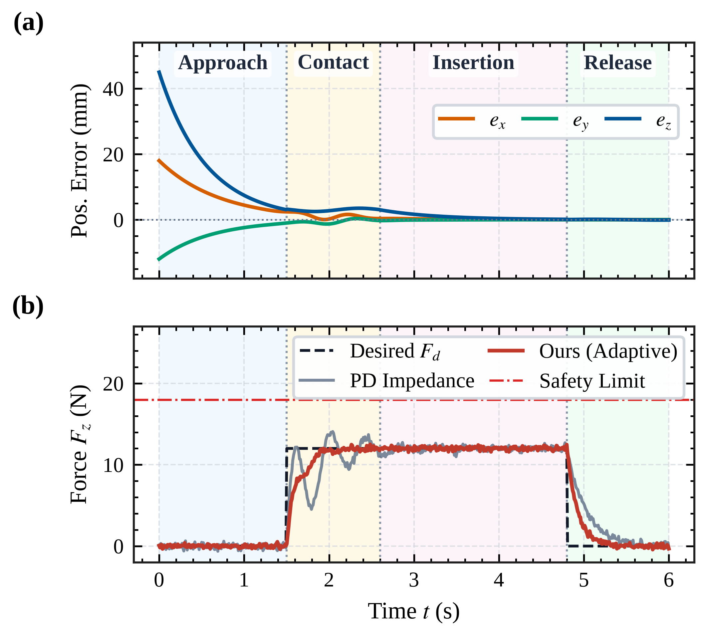
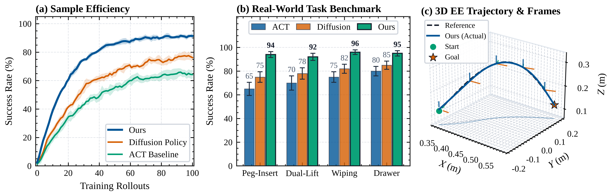
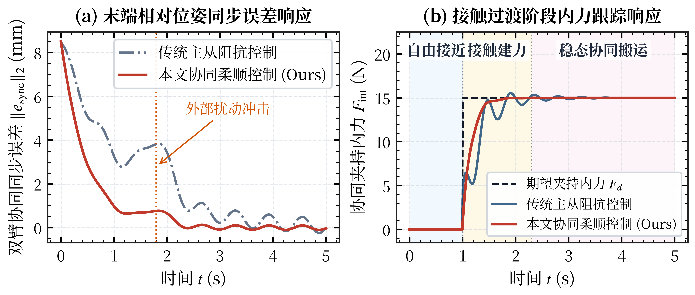

# maniplot: Robotic Manipulation Publication Plotting Toolkit & AI Agent Skill

<p align="center">
  <b>Publication-Ready Scientific Visualization for Robotic Manipulation (IEEE ICRA / IROS / RA-L / T-RO, CoRL / RSS & 国内硕博学位论文)</b>
</p>

`maniplot` 是一个专为**机器人操作（Robotic Manipulation）与具身智能（Embodied AI）**打造的轻量级 Python 出版级绘图工具包，同时内置了开箱即用的 **AI Agent Skill（支持 Antigravity / Claude Code / Cursor）**。

它的核心目标是：**彻底终结“每开一个新实验项目，都要重新向 AI Agent 输送一遍画图需求、调字号、调配色、改中文乱码”的苦恼。**

---

## ✨ 核心特性 (Key Features)

1. **一行代码切换顶会/学位论文标准 (`mplt.use_style`)**
   - **`"ieee"`**：严格对标 **ICRA / IROS / RA-L / T-RO** 双栏排版（单栏宽 `3.50 in`、跨双栏宽 `7.16 in`、Times/Liberation Serif + STIX 数学公式、朝内刻度、高对比色盲安全色板）。
   - **`"cn_thesis"`**：严格对标**国内工学硕博学位论文**（中文宋体 + 英文/数字 Times New Roman + STIX 公式混排，彻底告别中文方框乱码）。
   - **`"corl"`**：对标 **CoRL / RSS / Science Robotics** 现代无衬线风格（去上/右边框、Arial/Helvetica + NPG 顶刊配色）。
2. **100% 符合 IEEE PDF eXpress 审查要求**
   - 默认强制开启 `pdf.fonttype = 42` 与 `ps.fonttype = 42`（TrueType 嵌入），杜绝 Matplotlib 默认 Type 3 字体导致论文投稿系统拒稿。
   - 调用 `mplt.savefig(fig, path)` 自动同时导出 **矢量图 `.pdf`** 与 **`600 DPI` 高清 `.png`**。
3. **专为机器人操作（Manipulation）封装的 4 大高频原语**
   - `mplt.add_task_phases()`：一键为力位跟踪时序图添加**操作阶段半透明背景色块与顶部标签**（如 *Approach $\rightarrow$ Contact $\rightarrow$ Insertion $\rightarrow$ Release*）。
   - `mplt.plot_ci_curves()`：多随机种子（Multi-seed）强化学习/模仿学习/收敛曲线（均值实线 + $\pm 1\text{ SD} / 95\%\text{ CI}$ 阴影带 + 滑动平滑）。
   - `mplt.plot_benchmark_bars()`：多任务成功率/误差对比分组柱状图（带误差棒、柱顶数值标注、自动加粗高亮 `Ours`）。
   - `mplt.plot_3d_trajectory()`：机械臂末端 3D 空间轨迹 + **6-DoF 姿态局部坐标系（RGB Triads）** + **$XY$ 平面阴影投影**。
4. **原生内置 AI Agent Skill (`skills/maniplot/SKILL.md`)**
   - 软链接至全局配置目录后，你在本机任何项目对 Agent 说一句“把这份 CSV 画出来”，Agent 会自动调用 `maniplot` 生成符合出版规范的图表。

---

## 🖼️ 效果展示 (Showcase Gallery)

### 1. IEEE 单栏标准：柔顺插孔操作（Peg-in-Hole）位姿误差与接触力阶段响应
*(3.50 inches width, Times/STIX typography, inward ticks, task phase shading)*



### 2. IEEE 跨双栏标准：训练收敛曲线、多任务基准测试与 3D 末端轨迹姿态图
*(7.16 inches width, 3-panel layout with Mean ± SD bands, benchmark bars, and 6-DoF RGB frames)*



### 3. 国内硕士学位论文标准：双臂协同柔顺控制中英混排对比图
*(中文宋体 + 英文/数字 Times New Roman + STIX 公式混排，支持外部扰动注释与阶段划分)*



---

## 🚀 快速安装与挂载（Windows & Linux 双端通用）

无论你在 **Ubuntu 工控机/服务器** 还是 **Windows 笔记本** 上，只需克隆仓库并运行一键配置脚本 [`setup_env.py`](setup_env.py)（零外部依赖，自动完成 Python 环境注册与全局 AI Agent Skill 链接）：

### Linux / macOS（推荐使用 `uv`）
```bash
git clone https://github.com/langxin11/maniplot.git ~/maniplot
uv run ~/maniplot/setup_env.py
# 或者使用系统 Python：python3 ~/maniplot/setup_env.py
```

### Windows (PowerShell / CMD)
```powershell
git clone https://github.com/langxin11/maniplot.git "$HOME\maniplot"
uv run "$HOME\maniplot\setup_env.py"
# 或者使用系统 Python：python "$HOME\maniplot\setup_env.py"
```

### ⚡ 为什么强烈推荐搭配 `uv run` 运行画图脚本？
做机器人实验时，你经常处于纯 C++ 的 **ROS 2 工作空间（`colcon_ws`）**，或是尚未安装 `matplotlib` 的 **Conda `base` 环境**（传统 `python plot.py` 极易报 `ModuleNotFoundError`）。
`maniplot` 的 Agent Skill 原生内置了 **PEP 723 单文件脚本依赖规范（`# /// script`）**：
- Agent 生成任何画图脚本后，会自动通过 **`uv run plot_xxx.py`** 执行；
- `uv` 会在毫秒级内复用全局缓存中的 `matplotlib` + `numpy` 环境并自动加载 `~/maniplot`，**既不污染你的 ROS 2 / Conda 环境，又彻底杜绝“换个虚拟环境就缺包报错”的痛点！**

> **跨平台（Windows/Linux）与多 Agent（Codex / Claude / Gemini / Cursor）全兼容设计**：
> - **全主流 AI Agent 自动挂载**：运行 `setup_env.py` 会一次性将 `SKILL.md` 自动挂载到：
>   - **OpenAI Codex**：`~/.codex/skills/maniplot`
>   - **Anthropic Claude Code**：`~/.claude/skills/maniplot`
>   - **Google Antigravity / Gemini**：`~/.gemini/config/skills/maniplot`
>   - **通用 Agent Skills 标准（Cursor / Windsurf / OpenCode）**：`~/.agents/skills/maniplot`
> - **字体动态探测**：`mplt.use_style()` 会在运行时自动检测当前操作系统已安装的字体（Windows 自动命中 `Times New Roman` + `SimSun 中易宋体`；Linux 自动命中 `Liberation Serif` + `Noto Serif CJK 思源宋体`），绝不在跨端运行时抛出 `findfont` 警告或中文方框乱码。
> - **Windows 免管理员权限挂载 Skill**：`setup_env.py` 在 Linux 下自动创建软链接（Symlink），在 Windows 下自动使用无需管理员权限的 NTFS 目录联接（`mklink /J`）。
> - **跨端 CSV 编码自动兼容**：提供 `headers, data = mplt.load_csv("log.csv")`，自动兼容 Windows Excel 导出的 `UTF-8-BOM` / `GBK` 与 Linux ROS 2 导出的 `UTF-8`。

---

## 💻 Python API 极简示例 (Quickstart)

```python
import maniplot as mplt
import numpy as np

# 1. 一键激活 IEEE 顶会样式（写中文大论文则改为 "cn_thesis"）
mplt.use_style("ieee")

# 2. 自动按 IEEE 单栏宽度 (3.5 in) 创建上下对齐子图
fig, axes = mplt.subplots(nrows=2, ncols=1, layout="ieee_single", height=3.1, sharex=True)

t = np.linspace(0, 6, 600)
axes[0].plot(t, 20 * np.exp(-1.5 * t), color=mplt.XYZ_COLORS["z"], label="$e_z$")
axes[0].set_ylabel("Pos. Error (mm)")
axes[0].legend(loc="upper right")

axes[1].plot(t, np.where(t > 1.5, 12.0, 0.0), "--", color=mplt.SEMANTIC_COLORS["reference"], label="Desired $F_d$")
axes[1].set_xlabel("Time $t$ (s)")
axes[1].set_ylabel("Force $F_z$ (N)")
axes[1].legend(loc="upper right")

# 3. 一键添加机器人操作阶段背景色块与 (a)(b) 序号
mplt.add_task_phases(axes, [(0.0, 1.5, "Approach"), (1.5, 4.5, "Contact & Insert"), (4.5, 6.0, "Release")])
mplt.add_panel_labels(axes)

# 4. 自动同时导出矢量图 (.pdf) 与 600 DPI 高清图 (.png)
mplt.savefig(fig, "figures/peg_in_hole_tracking")
```

---

## 📏 内置论文版面尺寸速查表 (Standard Dimensions)

| Layout Key | 物理宽度 (Width) | 适用期刊 / 会议 / 论文场景 |
| :--- | :--- | :--- |
| `"ieee_single"` | `3.50 in` (`8.89 cm`) | **ICRA, IROS, RA-L, T-RO** 单栏图（最常用） |
| `"ieee_double"` | `7.16 in` (`18.19 cm`) | **ICRA, IROS, RA-L, T-RO** 跨双栏通栏大图 |
| `"thesis_full"` | `5.80 in` (`14.73 cm`) | **国内硕博学位论文** A4 正文通栏标准图 |
| `"thesis_half"` | `2.85 in` (`7.24 cm`) | **国内硕博学位论文** 双图并排单张尺寸 |
| `"corl_single"` | `3.25 in` (`8.25 cm`) | **CoRL, RSS, NeurIPS** 半页宽图 |
| `"corl_double"` | `6.75 in` (`17.15 cm`) | **CoRL, RSS, NeurIPS** 通栏宽图 |

---

## 📄 License

Released under the [MIT License](LICENSE).
